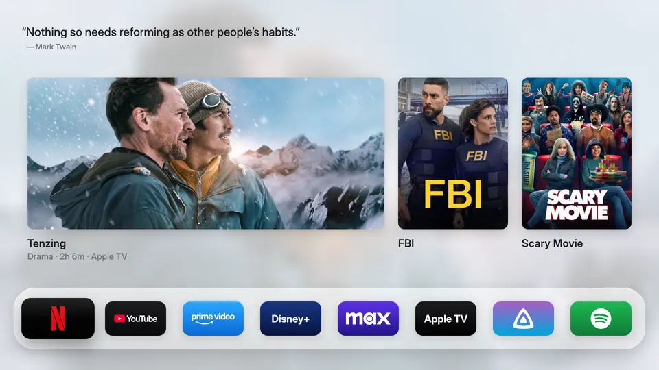

<div align="center">


# Free My TV (LG)

**A fast, ad-free home screen app for LG webOS TVs.**

Trending picks from your own apps, the weather at a glance, and a look that follows the sunset.

Based on [simbasjungles/free-my-tv](https://github.com/simbasjungles/free-my-tv) by Simba ([@simbasjungles](https://github.com/simbasjungles)) and its [contributors](https://github.com/simbasjungles/free-my-tv/graphs/contributors).
This fork keeps only the LG app; Google TV, Android TV and Samsung live upstream.



</div>

## What you get

- **No ads.** No sponsored rows, banners or autoplaying promos.
- **Your apps, front and center.** The streaming apps you use, on a glass shelf. Pick them and their order on the TV.
- **Trending, not sponsored.** Three fresh picks every hour (up to six, in Home Settings) from what's trending this week and the latest releases, only from apps you already have. Movies and Shows get their own tabs.
- **Weather and inputs, one press away.** ↓ opens a drawer with the hour-by-hour forecast (or the next 5 days), sunrise and sunset, and below it the antenna and HDMI inputs and shortcuts to All Apps and the settings.
- **Your home at a glance (optional).** Up to three [Home Assistant](#home-assistant) values at the top right (OK shows their last 24 hours) and a card of them in the drawer, next to the weather. Read only, live.
- **A thought to start with.** A short quote at the top, another with every start: Goethe, Lichtenberg, Ebner-Eschenbach or Nietzsche on a German TV, Wilde, Twain, Shaw or Thoreau elsewhere, always in the words they wrote, with their name.
- **Light by day, dark by night.** It follows your city's sunset.
- **A screensaver to match.** Full-screen photos of the picks with a big clock that moves to another corner with every photo, so nothing stays in place on an OLED panel. Optionally (*Watch from the screensaver*), OK opens the title on screen in its app.
- **Set up on the TV.** Language, city, temperature, theme, how many picks and which streaming services they come from, the weather card, the TMDB key, Home Assistant and the apps on the shelf, in *Home Settings*.
- **Nothing changed on the TV.** It installs through LG's Developer Mode. LG's home screen stays; Free My TV (LG) is one press of a number key away.

## Install

You need an LG TV with webOS 6 or newer (tested: OLED48C11LB, webOS 6.5) and a computer on the same Wi-Fi, with Python 3 and OpenSSH (`ssh`, `ssh-keygen`; already on macOS, Linux and Windows 10+).

1. **On the TV**, open the LG Content Store and install **Developer Mode**. Sign in with a free [LG developer account](https://webostv.developer.lge.com), turn on **Dev Mode Status** (the TV restarts), then turn on **Key Server**. Note the IP address and the passphrase it shows.
2. **On your computer**, get the code and build:
   ```bash
   git clone https://github.com/msbsh/free-my-tv-lg && cd free-my-tv-lg
   python3 webos/build.py
   ```
   The first build creates `config.properties`: put your city and your [TMDB key](#the-tmdb-key) there (and, if you like, your [Home Assistant](#home-assistant)), then build again.
3. **Install.** It builds the app again first. The first time, it asks for the TV's passphrase; updates don't:
   ```bash
   python3 webos/install.py 192.168.1.50
   ```
4. **On the TV**, while the app is open, hold a number key on the remote. From then on, that key opens it from anywhere. It's also in LG's app list, like any other app.

LG doesn't let apps installed through Developer Mode list the TV's apps. Until you allow more, the app shows the well-known ones it finds (Netflix, YouTube, Prime Video, Disney+, Apple TV, Plex and more) and asks the TV, once, for the access LG's phone app uses. Allow it on the TV, and from the next start all your apps show, with their icons.

Developer Mode lasts about 40 days: open the Developer Mode app now and then and press **EXTEND** (if it runs out, the TV removes the app; installing again brings it back). To remove the app: `python3 webos/install.py 192.168.1.50 --uninstall`.

Coming from upstream's Free My TV (`io.freemytv`)? This fork has its own app id (`de.msbsh.freemytvlg`), so both would sit side by side: remove the old one first, in LG's app list (its edit mode) or with `install.py --uninstall` from a checkout before the rename. Its TMDB key typed on the TV and the app-list permission don't carry over.

## Settings

The first values come from `config.properties`. Most can also be changed on the TV, in *Home Settings*, and the TV's choice wins.

| Key | What it does | Default |
|---|---|---|
| `tmdb_key` | Your free TMDB key, for the picks | empty |
| `tmdb_region` | Your country (two letters): which titles are on which app | `US` |
| `latitude`, `longitude` | Your city, for the weather and the sunset | New York |
| `city` | The name on the weather card | `Weather` |
| `hide_animation` | Leave cartoons and anime out of the picks | `false` |
| `language` | `auto` (follows the TV), or a language with a [translation](#translations) (`en`, `pt`, `es`, `de`, `ru`, `fr`, `ja`…) | `auto` |
| `temperature` | `C`, `F` or `auto` | `auto` |
| `theme` | `auto` (dark from sunset to sunrise), `light` or `dark` | `auto` |
| `hide_apps` | Apps to leave out of the shelf, All Apps and the picks, by id or name (part of it), comma separated | empty |
| `shelf_apps` | The shelf's apps in this order, by id or name (part of it), comma separated; changing it wins once over the shelf picked on the TV | empty |
| `drawer_first` | `true` opens the home screen with the drawer already out, so nothing has to be scrolled to reach the inputs | `false` |
| `ha_url` | Your Home Assistant, as the TV reaches it (`http://homeassistant.local:8123`) | empty |
| `ha_token` | A long-lived access token for it ([Home Assistant](#home-assistant)); only here, not on the TV | empty |
| `ha_top`, `ha_panel` | Entity ids, comma separated, in order: up to 3 at the top, any number in the drawer's card; changing them wins once over the ones picked on the TV | empty |

Changed something? Run `python3 webos/install.py <IP>` again: it builds before it installs (`--no-build` installs `FreeMyTV-webos.ipk` as it is). `--generic`, for `build.py` and `install.py`, builds without `config.properties`: no key, and the TV's time zone picks the city and the region.

### The TMDB key

Free, and it takes two minutes: create an account at [themoviedb.org](https://www.themoviedb.org/signup), then open [Settings → API](https://www.themoviedb.org/settings/api) and request a developer key. Paste the *API Read Access Token* (or the *API Key*) after `tmdb_key=`. It's your key: `config.properties` stays out of git.

You can also type it on the TV, in *Home Settings* → *TMDB key*: the short *API Key* (32 characters) is the easier one to type with the remote. TMDB checks it before it's saved, it stays on the TV, and it wins over the one in `config.properties` (*Remove the key* goes back to that one).

### Home Assistant

Read only: the app shows states, it never switches anything.

1. In Home Assistant, best as a user of its own without admin rights (a token can do everything its user can; Home Assistant has no read-only tokens): open your profile → *Security* → *Long-lived access tokens* → *Create token*.
2. Put it after `ha_token=` in `config.properties`, the address after `ha_url=`, and the entities you want after `ha_top=` and `ha_panel=`. Install again.
3. On the TV, *Home Settings* → *Home Assistant* changes the address, turns it off, and picks the values and their order from what Home Assistant has.

The app connects through Home Assistant's WebSocket API, so Home Assistant needs no change. Use `http://` in your network, or `https://` only with a certificate the TV trusts (a self-signed one fails). Next to the weather the card holds 6 values, alone 14. When Home Assistant can't be reached, the last values stay, dimmed, with the time they're from.

## How it works

- **Plain HTML, CSS and JavaScript** ([`web/`](web)), no frameworks, for the Chromium 79 of webOS 6.
- [`webos/build.py`](webos/build.py) packs it with `config.properties` into an `.ipk` without LG's tools, and [`webos/install.py`](webos/install.py) installs it through Developer Mode over SSH.
- It lists and opens apps and inputs through the TV's own service bus (Luna), as LG's launcher does. Where LG denies the app list, a small JS service in the package ([`webos/service`](webos/service)) asks the TV's remote control API.
- **Data** from TMDB (trending titles, new releases and which app streams what in your country), Open-Meteo (forecast, sunrise and sunset) and, if you set it up, your Home Assistant (states, live, over its WebSocket API).
- **Preview on a computer:** `python3 webos/build.py --preview`, then open `out/webos/index.html` (a stand-in lists sample apps).

| File | What it is |
|---|---|
| [`web/home.js`](web/home.js) | The home screen |
| [`web/tv.js`](web/tv.js) | The TV's apps, inputs and settings (Luna) |
| [`web/data.js`](web/data.js) | Picks and weather |
| [`web/ha.js`](web/ha.js) | Home Assistant, read only |
| [`web/strings.js`](web/strings.js) | Translations, dates and plurals |
| [`webos/build.py`](webos/build.py), [`webos/install.py`](webos/install.py) | The package and its install |
| [`assets/`](assets) | Catalogues, quotes, symbols and font the package carries |
| [`tests/`](tests) | The package and the screen against their baseline |

## Checks and tests

`tools/check.sh` validates the catalogues, builds the package, checks `web/` against what webOS 6 can run, and runs `tests/run.sh`: the package against its baseline, then the screen in Chromium with a fixed clock, the internet, a Home Assistant and a webOS TV faked (Playwright: the page, screenshots, the calls to the TV and the network, and Home Settings). It needs Python 3 and Node; the first run installs Playwright in `tests/`. Pull requests run it too, without the screenshots.

## Translations

Each language is one file, [`assets/i18n/<lang>.json`](assets/i18n), keyed by the English text in the code. *Automatic* follows the TV's language and uses any language that has a file (English otherwise); *Home Settings* → *Language* lists them all. Portuguese, Spanish, German, Russian, Thai and Turkish were translated by hand and are the reference; the others were machine-made.

- **Add a language:** `python3 tools/translate.py --new ca`, then fill `assets/i18n/ca.json` by hand, or with `ANTHROPIC_API_KEY` set, `python3 tools/translate.py --fill --lang ca` (only the strings go to the API).
- **After changing text in the code:** `python3 tools/translate.py` lists what each language lacks; `--fill` translates only that, `--prune` drops strings the code no longer uses, `--check` validates without writing.
- Text built at runtime has placeholders (`"{n} min ago"`); a key like `"unit|Automatic"` is the same English where a language may need another word; counts have plural forms (`"plural|one:{n} season|other:{n} seasons"`).
- Right-to-left languages aren't there yet (the layout isn't mirrored). Chinese, Japanese, Korean, Hindi and Thai use the TV's system font (the bundled Inter has no glyphs for them).

## Privacy

No accounts, no analytics, no tracking. The app talks to TMDB and Open-Meteo (with the coordinates you set, or your time zone's main city), and to your Home Assistant if you set one up. A TMDB key typed on the TV goes to TMDB only, to check it. The Home Assistant token goes only to your Home Assistant; it's in the package on the TV, so give it to a user without admin rights. Your settings stay on your computer and your TV.

## Credits

- [Free My TV](https://github.com/simbasjungles/free-my-tv) by Simba ([@simbasjungles](https://github.com/simbasjungles)) and [contributors](https://github.com/simbasjungles/free-my-tv/graphs/contributors) (MIT): the app this fork is cut from, built with [Claude Code](https://claude.com/claude-code).
- The LG version builds on what [@danielthejoker18](https://github.com/danielthejoker18) found in [FreeMyTvWebOS](https://github.com/danielthejoker18/FreeMyTvWebOS) (MIT): installing through Developer Mode and opening apps through the TV's service bus.
- This product uses the TMDB API but is not endorsed or certified by [TMDB](https://www.themoviedb.org/).
- Weather data by [Open-Meteo.com](https://open-meteo.com/) (CC BY 4.0).
- Quotes: in the public domain, copied from [Project Gutenberg](https://www.gutenberg.org) and [Wikisource](https://de.wikisource.org) (German in today's spelling).
- Icons: [Material Symbols](https://fonts.google.com/icons) (Apache 2.0). Font: [Inter](https://rsms.me/inter/) (SIL OFL 1.1). App logos: [Simple Icons](https://simpleicons.org) (CC0).
- Not affiliated with LG or any streaming service. App names and logos belong to their owners.

## License

[MIT](LICENSE), as upstream: the original notice stays, this fork adds its own line.
